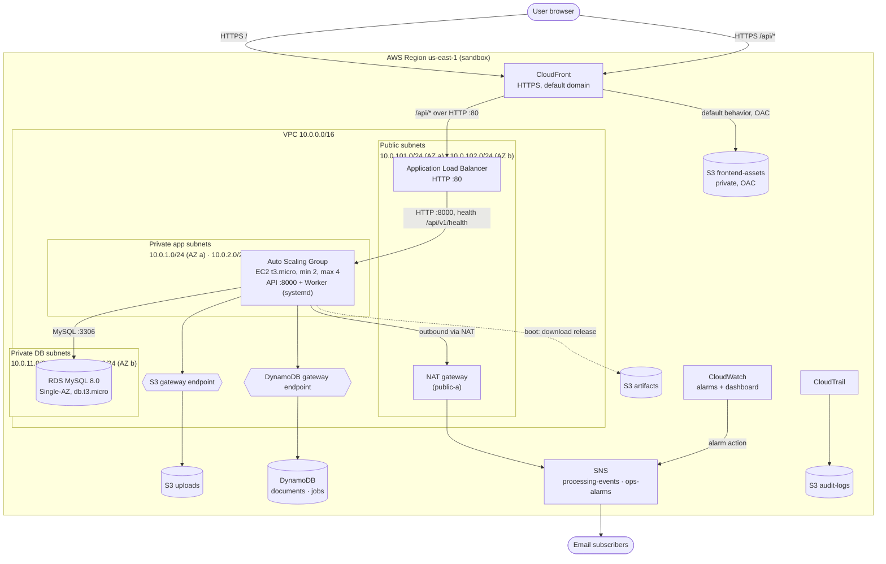
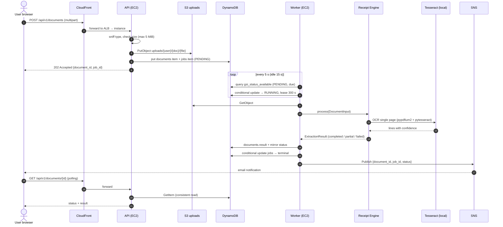

# Architecture

DocuProcess Cloud is a web platform where users upload receipts and invoices. Processing runs asynchronously on EC2. The target deployment is the AWS Academy Sandbox in `us-east-1`.

> **Visual version:** [`architecture.html`](architecture.html) draws the same architecture with AWS icons (`DLV-ARC-04`).
>
> **Status:** This document describes the designed architecture. After the first deployment, re-check every address and name against `terraform output` (see `deployment-guide.md`).

## 1. Diagram: target topology

Notes on the diagram:
- The first private subnet keeps the CIDR of the course illustration. The second AZ subnets are added because the ALB and the Auto Scaling Group require two AZs. See `specs/adr/ADR-004-two-az-subnet-layout.md`.
- Browsers never call the ALB directly. CloudFront routes `/api/*` to it, so the frontend and API are same-origin over HTTPS. See `specs/adr/ADR-030-same-origin-api-via-cloudfront.md`.
- The NAT gateway is single and not highly available (`specs/adr/ADR-005-single-nat-gateway.md`).

## 2. Diagram: upload and processing flow

## 3. Components

| Component | Technology | Runs on | Responsibility |
|---|---|---|---|
| Frontend | HTML, CSS, vanilla JS | S3 + CloudFront | Login, upload, history, document detail |
| API | Python 3.12, FastAPI, Uvicorn | EC2 (ASG), port 8000 | Auth, sessions, uploads, status queries |
| Worker | Python 3.12 | EC2 (ASG), systemd service | Claims jobs, runs the engine, persists results, publishes notifications |
| Receipt Extraction Engine | Python 3.12 library, no AWS imports, Tesseract OCR | Imported by the worker | Validation, OCR call, extraction, normalization, result validation |
| Relational store | RDS MySQL 8.0, Single-AZ | Private DB subnets | Users, sessions, roles |
| Document store | S3 `uploads` | S3 | Original files |
| NoSQL store | DynamoDB `documents`, `jobs` | DynamoDB | Document metadata, job state and queue, results |
| Notifications | SNS | SNS | Email on terminal job states; alarm notifications |
| Monitoring | CloudWatch | CloudWatch | Alarms on EC2, ALB, RDS; dashboard |
| Audit | CloudTrail | CloudTrail + S3 | API activity record |

Design rules that shape the system (each is an ADR):
- Everything runs on EC2. No Lambda (`ADR-023`).
- The engine is a pure library and never touches AWS (`ADR-011`).
- No message broker. The `jobs` table is the queue (`ADR-010`).
- Only the pre-existing instance profile is used. Terraform creates no IAM resources (`CON-IAM-01`).

## 4. Network summary

| Subnet | CIDR | AZ | Public IP | Used by |
|---|---|---|---|---|
| public-a | 10.0.101.0/24 | a | yes | ALB, NAT gateway |
| public-b | 10.0.102.0/24 | b | yes | ALB |
| app-a | 10.0.1.0/24 | a | no | ASG instances |
| app-b | 10.0.2.0/24 | b | no | ASG instances |
| db-a | 10.0.11.0/24 | a | no | RDS subnet group |
| db-b | 10.0.12.0/24 | b | no | RDS subnet group (required, even for Single-AZ) |

Security groups:

| Group | Inbound | Outbound |
|---|---|---|
| `alb-sg` | TCP 80 from `0.0.0.0/0` | TCP 8000 to `app-sg` |
| `app-sg` | TCP 8000 from `alb-sg` | All |
| `db-sg` | TCP 3306 from `app-sg` | None |

No security group allows SSH. Operators use SSM Session Manager.

## 5. Sandbox constraints that shaped the design

| Constraint | Design response | Reference |
|---|---|---|
| No IAM role creation | Use the pre-existing instance profile only | `CON-IAM-01` |
| RDS Single-AZ only | RDS Single-AZ, accepted risk | `ADR-003` |
| Max 4 instances in the ASG (course brief) | `max_size = 4` | `INF-ASG-01` |
| No custom domains | Default CloudFront and ALB DNS names | `CON-DNS-01` |
| ALB has no certificate | HTTP on the ALB; CloudFront is the HTTPS entry point | `ADR-025`, `ADR-030` |
| Only SSM for shell access | No key pairs, no bastion | `CON-EC2-05` |
| No Textract permission for the instance role | OCR runs locally with Tesseract | `ADR-012` |
| KMS list access only | No customer keys; RDS not encrypted at rest | `ADR-032` |

## 6. Known limitations (accepted)

Recorded in `risks-and-exceptions.md` when that file exists. Summary:
- Single NAT gateway and single-AZ RDS: a zone failure affects processing and the database (`ADR-005`, `ADR-003`).
- ALB traffic is HTTP inside AWS (`ADR-025`).
- The database password is read from SSM at boot (verified: the instance role can call `ssm:GetParameter`).
- RDS storage is not encrypted at rest (`ADR-032`).
