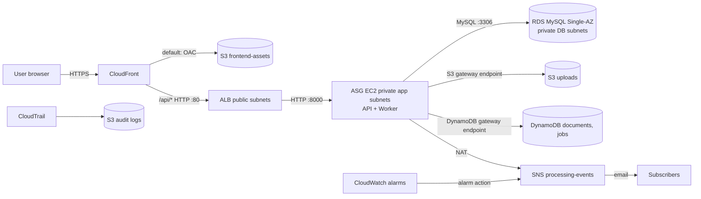

# 01 — Architecture

## 1. Context

The system runs in the AWS Academy Sandbox, region `us-east-1`. Constraints are in `02-aws-sandbox-constraints.md`. Every topology decision here is constrained by them.

## 2. Components

| ID | Component | Technology | Runs on | Responsibility |
|---|---|---|---|---|
| ARC-C-01 | Frontend | HTML/CSS/vanilla JS | S3 bucket `frontend-assets`, served by CloudFront | Login, upload, history, document detail |
| ARC-C-02 | Edge CDN | CloudFront | AWS edge | Serves the frontend over HTTPS with the default `*.cloudfront.net` domain |
| ARC-C-03 | Load balancer | Application Load Balancer (ALB) | Public subnets | Routes API traffic to healthy instances |
| ARC-C-04 | API | Python 3.12, FastAPI, Uvicorn | EC2 (ASG), port 8000 | REST API: auth, sessions, uploads, status queries |
| ARC-C-05 | Worker | Python 3.12 | EC2 (ASG), same instances as API, systemd service | Polls for jobs, runs the engine, persists results, publishes notifications |
| ARC-C-06 | Receipt Extraction Engine | Python 3.12 library | Imported by the worker | Validates, OCRs, extracts, normalizes, validates results. No AWS imports. |
| ARC-C-07 | Relational database | RDS MySQL 8.0, Single-AZ | Private DB subnets | Users, sessions, roles |
| ARC-C-08 | Document store | S3 bucket `uploads` | S3 | Original uploaded files |
| ARC-C-09 | NoSQL store | DynamoDB tables `documents`, `jobs` | DynamoDB | Document metadata, job state, results |
| ARC-C-10 | Notifications | SNS topic `processing-events` | SNS | Email to subscribers on terminal job states |
| ARC-C-11 | Monitoring | CloudWatch alarms and dashboard | CloudWatch | EC2, ASG, ALB, RDS metrics; alarm actions to SNS |
| ARC-C-12 | Audit | CloudTrail trail + S3 log bucket | CloudTrail | Records API activity in the account |
| ARC-C-13 | Release artifacts | S3 bucket `artifacts` | S3 | Versioned application tarballs consumed by EC2 userData |

## 3. Topology

Note: SNS is reached through the NAT gateway because no interface endpoint is planned (see `ADR-006`).

## 4. Network layout

Details and CIDRs are normative in `03-infrastructure.md` section 3. Summary:

- One VPC, `10.0.0.0/16`, in `us-east-1`.
- Two **public** subnets (one per AZ) for the ALB and the NAT gateway.
- Two **private application** subnets (one per AZ) for EC2 instances. No public IPs.
- Two **private database** subnets (one per AZ) for RDS. RDS is Single-AZ, but a DB subnet group requires two AZs.
- One NAT gateway for outbound traffic from private subnets (single, not HA; see `ADR-005`).
- Gateway VPC endpoints for S3 and DynamoDB (free) so that data traffic does not use the NAT.

### Deviation from the course diagram (documented on purpose)

The course diagram shows one private subnet (`10.0.1.0/24`). An ALB and an Auto Scaling Group that spans two AZs require **two** private subnets and **two** public subnets. We adopt the diagram's CIDR for the first private subnet and add the others. This is recorded as `ADR-004`. The architecture diagram in `docs/` must show the real layout, not the illustration.

## 5. Request flows

### Flow 1 — Static site
1. Browser requests `https://<cf-domain>/`.
2. CloudFront fetches the object from the private S3 bucket using Origin Access Control.
3. The browser loads the frontend. The frontend calls the API with the **relative** base path `/api/v1` (`ARC-FLOW-01`), which CloudFront routes to the ALB. The browser never calls the ALB directly (`ADR-030`).

### Flow 2 — Upload and processing
1. Browser sends `POST /api/v1/documents` (multipart) to the ALB.
2. API validates the session, reads the file, checks the sniffed type and size, and writes the object to S3 (`uploads` bucket).
3. API writes `documents` item and `jobs` item (status `PENDING`) to DynamoDB, then returns `202 Accepted`.
4. Worker polls the `jobs` table (GSI on status and `available_at`), claims a job with a conditional update, and sets it to `RUNNING` with a lease.
5. Worker downloads the object from S3 and passes the bytes to the engine.
6. Engine returns a structured result.
7. Worker writes the result to `documents`, sets the job to a terminal state, and publishes an SNS message.
8. Browser polls `GET /api/v1/documents/{id}` until the status is terminal.

### Flow 3 — Health and scaling
1. ALB health checks `GET /api/v1/health` on each instance.
2. Unhealthy instances are replaced by the ASG (`ELB` health check type).
3. CPU target tracking adds or removes instances between min 2 and max 4.

## 6. Architectural rules

- **ARC-RULE-01** The engine MUST be a pure library. It receives bytes and returns a result. It does not know about S3, DynamoDB, SNS, or HTTP.
- **ARC-RULE-02** Only the worker and the API talk to AWS services. The engine defines an OCR provider interface (`ENG-PROV-*`). The OCR provider used in v1 is Tesseract, which runs on the instance and needs no AWS call (`ADR-012`).
- **ARC-RULE-03** The API and the worker never call each other. The only shared state is DynamoDB and RDS.
- **ARC-RULE-04** No component is exposed on a public IP except the ALB (and the NAT gateway's Elastic IP, which is outbound-only). CloudFront is the only public entry point for browsers. EC2 and RDS are private.
- **ARC-RULE-08** The browser talks to exactly one origin (the CloudFront domain). Frontend and API are same-origin (`ADR-030`).
- **ARC-RULE-05** There are no message brokers and no per-stage microservices. The job queue is the DynamoDB `jobs` table.
- **ARC-RULE-06** Every compute capability runs on EC2. Lambda is not used (sandbox constraint).
- **ARC-RULE-07** Instance-level secrets are read at boot from SSM Parameter Store (`SEC-SEC-02`).

## 7. Deployment topology per environment

Only one environment exists: `sandbox`. Terraform state is local to the operator's machine and is never committed (`INF-STATE-01`).
